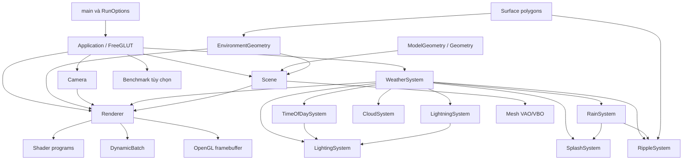

# 01 — Tổng quan project và bản đồ tài liệu

Bộ tài liệu review mã nguồn hiện tại, ngày **23/11/2026**, viết cho học tập và báo cáo môn Đồ họa máy tính. Chỉ tạo Markdown trong `docs/`; không sửa source, shader, CMake hoặc README, không cài thư viện và không tự sửa lỗi.

## Mục lục

1. [Tổng quan](01_PROJECT_OVERVIEW.md)
2. [Giải thích từng file, kiểu và hàm](02_SOURCE_CODE_WALKTHROUGH.md)
3. [Các thuật toán thực sự được dùng](03_GRAPHICS_ALGORITHMS.md)
4. [Công thức và ví dụ tính toán](04_MATHEMATICAL_FORMULAS.md)
5. [Toàn bộ shader GLSL](05_GLSL_SHADERS.md)
6. [Vòng đời, một frame, input và CLI](06_APPLICATION_FLOW.md)
7. [Kiểm thử và hiệu năng](07_TESTING_AND_PERFORMANCE.md)
8. [Ưu điểm, hạn chế và đề xuất](08_LIMITATIONS_AND_IMPROVEMENTS.md)
9. [Câu hỏi thuyết trình](09_PRESENTATION_QA.md)
10. [Chỉ mục mọi hàm](10_FUNCTION_INDEX.md)

## Mục tiêu và công nghệ

Ứng dụng rasterization 3D chạy trực tiếp OpenGL: cảnh ground 20×20, một nhà, bốn cây, ba đá; mưa, sét, mây, mặt đất ướt, vũng nước và đồng hồ ngày/đêm. Không có game engine hoặc asset loader. Mesh được tạo trên CPU và upload tới GPU; shader tự tính màu/vật liệu/fog.

[CMakeLists.txt:1](../CMakeLists.txt#L1) yêu cầu CMake≥3.16, C++17 không extensions, OpenGL, GLUT (implementation ở đây dùng header/API **FreeGLUT**), GLEW, `glm CONFIG`. `scene_core` chỉ link GLM; executable thêm OpenGL::GL/GLUT::GLUT/GLEW::GLEW. Dùng STL/random/chrono/filesystem, Linux `/proc`, `getrusage`, `sysconf` và GLX trong benchmark. Không có dependency audio, texture, ImGui hoặc mạng.

Ứng dụng yêu cầu OpenGL≥3.3 Core và depth≥16 bit ở [Application.cpp:91](../src/Application.cpp#L91); GLSL `#version 330 core`. GLEW khởi tạo sau context; header GLEW phải đứng trước FreeGLUT. Sáu shader được CMake COPYONLY sang đường dẫn build tuyệt đối `RAIN_SHADER_DIR`; di chuyển build tree cần configure/build lại.

## Chức năng đã có

- 23 vật thể Scene, **3264 tam giác tĩnh**; 9 nhóm vật liệu nhà, bark/foliage của 4 cây, 3 đá, 1 mesh cỏ, ground và 3 vũng nước gộp.
- 4 mesh mây, mỗi mesh 728 tam giác; trường Gaussian 5 lobe tạo skin lúc khởi tạo, không render sphere chồng hiện tại.
- Pool mưa 1000, splash 512, ripple 48; gió/gravity/semi-implicit Euler, recycling, hit plane Y 0 và sampling.
- Sét 32 đoạn chính+6×8 nhánh=80 đoạn, 1..3 pulse; billboard core/halo, flash point lighting và cache geometry.
- RGB ambient/directional ngày đêm, cửa sổ phát sáng, đèn ấm xấp xỉ, Blinn–Phong, Schlick sky-color reflection; fog exponential và sky gradient.
- Camera 3 preset, mouse drag, keyboard toggles; 5 CPU test executables, GUI smoke/capture và capped/unlocked benchmark.

Không có shadow mapping, OIT, volumetric cloud/rain/fog, HDR/bloom, SSR/planar reflection, camera/object collision, audio. Một số primitive legacy chỉ được test dùng; tài liệu 03 phân biệt với pipeline hiện tại.

## Cấu trúc hiện tại

```text
3D-Rain-Thunderstorm/
├── CMakeLists.txt
├── README.md
├── .gitignore       (bỏ qua build*, .cache, PPM và core dump)
├── include/
│   ├── Application.hpp
│   ├── Benchmark.hpp
│   ├── Camera.hpp
│   ├── CloudSystem.hpp
│   ├── DynamicBatch.hpp
│   ├── EnvironmentGeometry.hpp
│   ├── Geometry.hpp
│   ├── LightingSystem.hpp
│   ├── LightningSystem.hpp
│   ├── Material.hpp
│   ├── Mesh.hpp
│   ├── ModelGeometry.hpp
│   ├── RainSystem.hpp
│   ├── Renderer.hpp
│   ├── RippleSystem.hpp
│   ├── Scene.hpp
│   ├── Shader.hpp
│   ├── SplashSystem.hpp
│   ├── Surface.hpp
│   ├── TimeOfDaySystem.hpp
│   └── WeatherSystem.hpp
├── src/
│   ├── Application.cpp
│   ├── Benchmark.cpp
│   ├── Camera.cpp
│   ├── CloudSystem.cpp
│   ├── DynamicBatch.cpp
│   ├── EnvironmentGeometry.cpp
│   ├── Geometry.cpp
│   ├── LightingSystem.cpp
│   ├── LightningSystem.cpp
│   ├── Mesh.cpp
│   ├── ModelGeometry.cpp
│   ├── RainSystem.cpp
│   ├── Renderer.cpp
│   ├── RippleSystem.cpp
│   ├── Scene.cpp
│   ├── Shader.cpp
│   ├── SplashSystem.cpp
│   ├── Surface.cpp
│   ├── TimeOfDaySystem.cpp
│   ├── WeatherSystem.cpp
│   └── main.cpp
├── shaders/
│   ├── effects.frag
│   ├── effects.vert
│   ├── object.frag
│   ├── object.vert
│   ├── sky.frag
│   └── sky.vert
├── tests/
│   ├── core_tests.cpp
│   ├── environment_tests.cpp
│   ├── lighting_time_tests.cpp
│   ├── model_tests.cpp
│   └── weather_tests.cpp
├── assets/
│   ├── audio/      (rỗng ở snapshot này)
│   └── textures/   (rỗng ở snapshot này)
├── build/          (đã có executable, library, copied shaders, CMake metadata)
│   └── reports/    (log/ảnh lịch sử, bị gitignore)
├── build-sanitize/ (build và log sanitizer đã có)
├── .git/           (metadata Git)
├── .agents/ .codex/ .aws/ (thư mục môi trường, không phải module runtime)
└── docs/           (10 tài liệu của lần review này)
```

## Bảng module

| Module | File header | File implementation | Nhiệm vụ | Phụ thuộc |
|---|---|---|---|---|
| Application | [include/Application.hpp](../include/Application.hpp) | [src/Application.cpp](../src/Application.cpp) | Vòng đời/input/smoke | Renderer, Benchmark, FreeGLUT |
| Benchmark | [include/Benchmark.hpp](../include/Benchmark.hpp) | [src/Benchmark.cpp](../src/Benchmark.cpp) | Timer queries/CPU/RSS | WeatherSystem, GLEW/GLX, Linux /proc |
| Camera | [include/Camera.hpp](../include/Camera.hpp) | [src/Camera.cpp](../src/Camera.cpp) | View/projection/movement | GLM |
| CloudSystem | [include/CloudSystem.hpp](../include/CloudSystem.hpp) | [src/CloudSystem.cpp](../src/CloudSystem.cpp) | 4 cluster×5 lobe | GLM |
| DynamicBatch | [include/DynamicBatch.hpp](../include/DynamicBatch.hpp) | [src/DynamicBatch.cpp](../src/DynamicBatch.cpp) | Persistent dynamic VAO/VBO | GLEW, GLM |
| EnvironmentGeometry | [include/EnvironmentGeometry.hpp](../include/EnvironmentGeometry.hpp) | [src/EnvironmentGeometry.cpp](../src/EnvironmentGeometry.cpp) | Cloud skin/rocks/grass/water | Geometry, CloudSystem, Surface, ModelGeometry |
| Geometry | [include/Geometry.hpp](../include/Geometry.hpp) | [src/Geometry.cpp](../src/Geometry.cpp) | Primitive triangle lists | GLM, Surface |
| LightingSystem | [include/LightingSystem.hpp](../include/LightingSystem.hpp) | [src/LightingSystem.cpp](../src/LightingSystem.cpp) | Day/night/flash/wet/fog | GLM, TimeOfDaySystem |
| LightningSystem | [include/LightningSystem.hpp](../include/LightningSystem.hpp) | [src/LightningSystem.cpp](../src/LightningSystem.cpp) | Midpoint displacement và pulses | CloudSystem, mt19937 |
| Material | [include/Material.hpp](../include/Material.hpp) | Không có; aggregate/enum | MaterialKind/response | GLM |
| Mesh | [include/Mesh.hpp](../include/Mesh.hpp) | [src/Mesh.cpp](../src/Mesh.cpp) | Static VAO/VBO RAII | Geometry, GLEW |
| ModelGeometry | [include/ModelGeometry.hpp](../include/ModelGeometry.hpp) | [src/ModelGeometry.cpp](../src/ModelGeometry.cpp) | House/tree procedural | Geometry, GLM, mt19937 |
| RainSystem | [include/RainSystem.hpp](../include/RainSystem.hpp) | [src/RainSystem.cpp](../src/RainSystem.cpp) | 1000 drop/impact/recycle | GLM, mt19937 |
| Renderer | [include/Renderer.hpp](../include/Renderer.hpp) | [src/Renderer.cpp](../src/Renderer.cpp) | 3 program/ordered render passes | Scene, Camera, Weather, Shader, DynamicBatch |
| RippleSystem | [include/RippleSystem.hpp](../include/RippleSystem.hpp) | [src/RippleSystem.cpp](../src/RippleSystem.cpp) | 48 slot/radius/alpha | GLM, mt19937 |
| Scene | [include/Scene.hpp](../include/Scene.hpp) | [src/Scene.cpp](../src/Scene.cpp) | 23 objects và Mesh ownership | Mesh, Material, models, environment, Surface |
| Shader | [include/Shader.hpp](../include/Shader.hpp) | [src/Shader.cpp](../src/Shader.cpp) | Compile/link/uniform RAII | GLEW, C++file I/O |
| SplashSystem | [include/SplashSystem.hpp](../include/SplashSystem.hpp) | [src/SplashSystem.cpp](../src/SplashSystem.cpp) | 512 slot/emission/lifetime | GLM, mt19937 |
| Surface | [include/Surface.hpp](../include/Surface.hpp) | [src/Surface.cpp](../src/Surface.cpp) | 3 polygon chung geometry/collision | GLM |
| TimeOfDaySystem | [include/TimeOfDaySystem.hpp](../include/TimeOfDaySystem.hpp) | [src/TimeOfDaySystem.cpp](../src/TimeOfDaySystem.cpp) | Hour/duration/auto advance | C++cmath/string |
| WeatherSystem | [include/WeatherSystem.hpp](../include/WeatherSystem.hpp) | [src/WeatherSystem.cpp](../src/WeatherSystem.cpp) | Fixed-step orchestration | Các module thời tiết/lighting/time, Surface |
| Entry | Không có | [src/main.cpp](../src/main.cpp#L10) | CLI và main | Application, C++exceptions |

Các test: core_tests, weather_tests, model_tests, environment_tests, lighting_time_tests link scene_core và không tạo context. Shader pairs: object, effects, sky. CMake là file cấu hình duy nhất tìm thấy; options runtime đến từ RunOptions/CLI/phím, không có JSON/INI configuration loader.

## Quan hệ module và ownership



Các mũi tên có nghĩa sử dụng/luồng dữ liệu, không phải tất cả đều sở hữu. Application sở hữu scene/renderer/benchmark qua unique_ptr; Scene sở hữu Mesh, SceneObject chỉ giữ const pointer. Weather sở hữu module CPU theo giá trị. Renderer sở hữu shader/sky/cloud/batch. Không có EBO trong implementation.

## Đối chiếu phạm vi và kết quả review

| Nội dung | Tổng số phát hiện | Tổng số đã giải thích | Còn thiếu |
|---|---:|---:|---:|
| Source files (21 cpp+21 hpp+5 test cpp+6 GLSL) |53|53|0|
| Classes/structs/enums tường minh (16/19/2) |37|37|0|
| Functions có tên, gồm 9 GLSL |257|257|0|
| Lambda |23|23|0|
| Khai báo =delete (không có implementation) |10|10|0|
| Shader files |6|6|0|
| Nhóm thuật toán/kỹ thuật được kiểm kê trong 03 |33|33|0|
| Nhóm công thức trong 04 |30|30|0|

Số đếm dựa trên thân hàm thực, không cộng prototype trùng hoặc hàm thư viện/implicit special members. File 02 có từng anchor; file 10 có 290 dòng gồm 280 thân callable và 10 khai báo delete. Các alias Clock/House/MeshData/Point được ghi riêng trong 02. Đọc thêm CMake, toàn README và log được dẫn ở 07.

Đã chạy trực tiếp **5/5 executable CPU có sẵn** và đều exit 0. Không chạy build, CTest runner, GUI, sanitizer hay benchmark mới trong lần review; vì vậy không sinh thêm object/binary/log/capture trong project. Số performance/GUI/sanitizer có trích đều là log đã có, không phải phép đo mới. Không xác minh trực tiếp cảm giác điều khiển, render trên phiên đồ họa hiện tại, VRAM, hoặc throughput dài hạn của bản mới nhất.

## Cách học và chuẩn bị báo cáo

Đọc 01→06 để hiểu ownership/frame; học Geometry/Camera/Rain/Lightning trước trong 02; dùng 04 để tự tính ví dụ và 05 để giải thích CPU/GPU. Đọc 07 trước khi nêu bất kỳ FPS nào, 08 để trả lời phần giới hạn, 09 để luyện hỏi đáp. Khi dùng README lưu ý các đoạn đầu còn ghi số liệu/thuật toán của phiên bản cũ, ví dụ sphere cloud 100 triangles hoặc puddle 16 triangles không mô tả Scene hiện tại.

## Kiểm định tài liệu và phạm vi chưa xác minh

Đã đối chiếu 290 mục của function index với signature/số dòng nguồn và anchor giải thích riêng; trong đó có 280 thân hàm/lambda và 10 khai báo delete. Đã kiểm tra sự tồn tại của file đích, anchor nội bộ, dòng source trong phạm vi hợp lệ, bảng Markdown đủ cột và code/math fences khép kín. Năm block Mermaid đã kiểm tra cấu trúc tĩnh (loại sơ đồ, dấu ngoặc, block loop/alt/opt/end); **chưa render bằng Mermaid engine** vì môi trường không có công cụ đó. LaTeX cũng chưa được kiểm tra bằng engine của giao diện hiển thị.

Checksum các .cpp/.hpp/.vert/.frag và CMakeLists.txt khớp snapshot đầu kiểm kê. README có thay đổi khoảng trắng ở cuối file xuất hiện trong lúc review; tác vụ này không ghi vào README và giữ nguyên thay đổi đó. Không tuyên bố toàn bộ working tree sạch: các file docs mới là thay đổi do tác vụ này tạo, README được ghi nhận riêng. Các script hỗ trợ kiểm kê/kiểm định tạm nằm trong /tmp, không thêm vào repository.

Độ đầy đủ của danh mục không thay thế kiểm chứng runtime: chưa build mới, chưa GUI/sanitizer/benchmark mới, chưa thử mọi seed/cấu hình/input, chưa render sơ đồ hoặc đo VRAM. Những giới hạn này được nêu rõ tại07–08.
