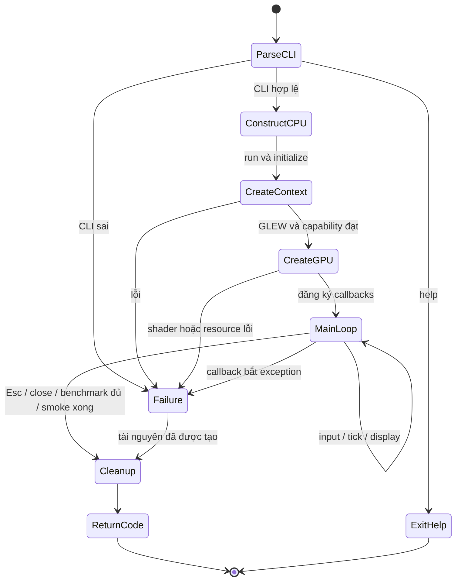
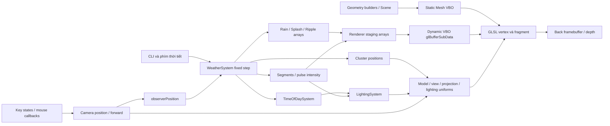
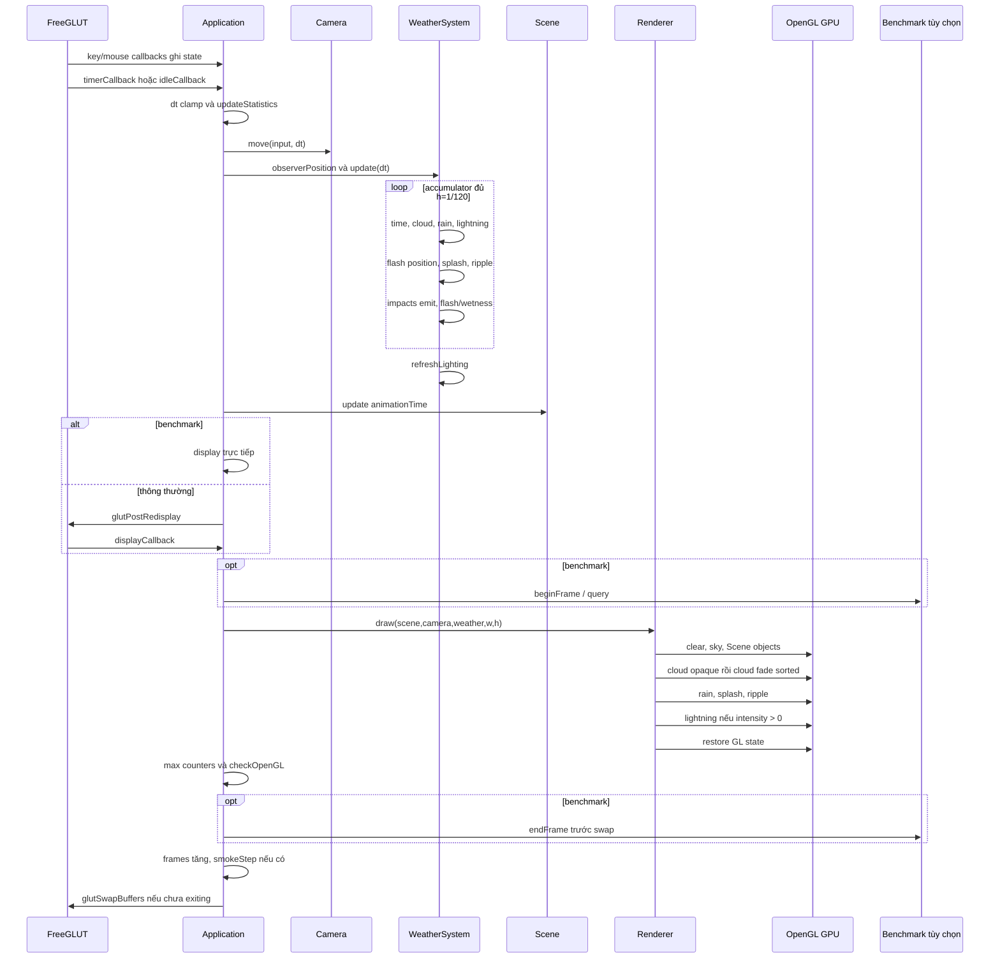

# 06 — Vòng đời, một frame, input và CLI

[Tổng quan](01_PROJECT_OVERVIEW.md) · [Từng hàm](02_SOURCE_CODE_WALKTHROUGH.md) · [Kiểm thử](07_TESTING_AND_PERFORMANCE.md)

## Mục lục

- [Initialization → Update → Render → Cleanup](#s01)
- [Luồng dữ liệu CPU → GPU](#s02)
- [Tick và deltaTime](#s03)
- [Thứ tự update chính xác](#s04)
- [Một frame tới framebuffer](#s05)
- [Input và callback](#s06)
- [Toàn bộ CLI thực tế](#s07)
- [Cleanup và lỗi](#s08)

## Initialization → Update → Render → Cleanup

`main` [src/main.cpp:10](../src/main.cpp#L10) parse CLI trước khi tạo Application. Constructor Application chỉ move options và dựng value members CPU. `run` thiết lập singleton callback, gọi `initialize`, đặt mốc steady clock **sau initialization**, rồi đăng ký timer/idle và vào `glutMainLoop`.

`initialize` [Application.cpp:91](../src/Application.cpp#L91) tạo context OpenGL 3.3 Core với double RGBA/depth; GLEW chỉ init sau cửa sổ. Kiểm version/profile/depth, dựng Renderer và Scene trong context, áp CLI fog/time, tùy chọn Benchmark. Context yêu cầu depth≥16 bit; log cũ cho thấy 24 bit nhưng không hard-code phải 24. Shader/program/buffer tạo trong constructors owner sau context.

## Luồng dữ liệu CPU → GPU

Không có Scene graph phân cấp runtime. Nhà được bake từ các primitive vào chín nhóm mesh; Scene là vector phẳng 23 SceneObject. Model/normal matrix của vật tĩnh tính một lần. Mây có cached skin thuộc Renderer và translation mới mỗi frame. Cây sway trong vertex shader, không upload lại Mesh khi animationTime tăng.

## Tick và deltaTime

[Application::tick:170](../src/Application.cpp#L170): lấy now từ steady_clock; `dt=clamp(now-lastTick,0,0.1)`; lưu lastTick rồi **updateStatistics trước update**. Benchmark hết hạn được report và cleanup ngay, không update/render frame mới. Chế độ benchmark capped đăng ký timer 16 ms tiếp theo trước render để chi phí render không cộng toàn bộ vào khoảng nghỉ. Chế độ thường đăng ký timer tiếp ở cuối tick; unlocked dùng idle callback.

Nếu window không visible, chế độ thường bỏ update/post Re display nhưng lastTick vẫn cập nhật; benchmark vẫn update và display trực tiếp. `glutPostRedisplay` chỉ yêu cầu redraw; FreeGLUT quyết định lúc gọi display. Resize/expose cũng có thể sinh display độc lập, nên số tick và số frame không bắt buộc bằng nhau. `glutSwapBuffers` có thể chờ driver/compositor dù không có `sleep` trong source.

## Thứ tự update chính xác

[Application::update:159](../src/Application.cpp#L159):

1. Đọc keys thành hướng `(D-A,E-Q,W-S)`.
2. `camera.move(direction,dt)`; camera không bị Space đóng băng.
3. Ghi `weather.observerPosition=camera.position()`.
4. `weather.update(dt)`.
5. `scene.update(dt,weather.paused)` để tăng animationTime cây khi không pause.

[WeatherSystem::update:30](../src/WeatherSystem.cpp#L30) trả sớm khi pause/dt sai/≤0 nhưng vẫn refreshLighting. Nếu hợp lệ, cộng tối đa 0, 1 giây vào accumulator. Mỗi substep `h=1/120` chạy đúng thứ tự:

1. TimeOfDay update.
2. Cloud update nếu cloudsEnabled.
3. Rain update nếu rainEnabled; ghi impactCount/impacts của substep này.
4. Lightning update với randomEnabled=lightningEnabled, luôn đọc dữ liệuCloud hiện có.
5. Lighting setFlashPosition từ đầu segment hoặc vị trí fallback.
6. Splash cũ update/expire.
7. Ripple cũ update/expire.
8. Nếu rainEnabled: duyệt từng impact, emit splash sampled, tính waterMargin rồi emit ripple sampled.
9. Lighting update flash và wetness với dt=h, rainEnabled.
10. Trừ accumulator, chặn phần dư không âm.

Sau toàn bộ substep mới `refreshLighting` để pha ánh sáng nền theo giờ và storminess. Particle vừa emit chưa được tích phân trong chính substep phát nó; sẽ update ở substep sau, có thể ngay trong cùng tick nếu còn nhiều bước. Không có render interpolation. Splash/ripple có sẵn vẫn update khi tắt rain; wetness giảm. Clouds tắt thì dừng/hide nhưng Lightning vẫn dùng các vị trí cloud được giữ lại. Manual L không phụ thuộc rain/cloud/auto-lightning toggles.

## Một frame tới framebuffer

[Renderer::draw:84](../src/Renderer.cpp#L84) vẽ theo thứ tự bảng dưới. Không gom tất cả object trong suốt rồi sort chung.

| Pass | Thứ tự/vật thể | Depth test | Depth write | Blend/culling |
|---|---|---|---|---|
| Clear | color và depth | — | write mask đầu frame đã được phục hồi | — |
| Sky | một fullscreen triangle | Tắt | Tắt | Blend tắt; CCW/back cull vẫn bật |
| Scene | ground → batched puddles → 9 house parts → bark/foliage của 4 cây → 3 đá → cỏ | LESS | Bật | Blend tắt, cull BACK |
| Clouds opaque | Những cụm coverage=1 | LESS | Bật | Blend tắt, cull BACK |
| Clouds fade | Chỉ coverage trong (0, 1), sort giảm projected center depth | LESS | Tắt | SRC_ALPHA / ONE_MINUS_SRC_ALPHA; cull BACK |
| Rain | 1 batch 1000 lines nếu bật | LESS | Tắt | Standard alpha; line width 1 |
| Splash | 1 batch slot sống nếu có | LESS | Tắt | Standard alpha; line width 1 |
| Ripple | 1 batch vòng 12 cạnh nếu có | LESS | Tắt | Standard alpha |
| Lightning | 1 batch core+halo, active và flash>0 | LESS | Tắt | Standard alpha; cull tắt tạm |
| End | VAO 0/program 0 | Bật | Bật | Blend tắt, cull BACK bật |

Water và Glass nằm trong opaque Scene: alpha=1. Số liệu triangle là **submit trước culling/occlusion**, không phải diện tích ảnh. Rain/splash/ripple tính bằng line segments riêng.

## Input và callback

Nguồn [Application::key:231](../src/Application.cpp#L231), mouse handlers [291](../src/Application.cpp#L291), wrappers [705](../src/Application.cpp#L705). Tất cả phím chữ được lowercase; keyDownCallback gọi key(k, true), keyUpCallback gọi key(k, false). Release chỉ cập nhật keys, không thực hiện toggle lần nữa. Auto key repeat bị tắt.

| Phím/thao tác | Callback/handler | State/hàm đích | Ảnh hưởng |
|---|---|---|---|
| W/S | key down/up → key; update đọc | keys[w/s], Camera::move localZ | Tiến/lùi theo forward gồm cả Y |
| A/D | Như trên | keys[a/d], local X | Strafe theo right |
| Q/E | Như trên | keys[q/e], local Y | Hạ/nâng theo world up |
| Chuột trái down/up | mouseButtonCallback → mouseButton | dragging, mouseX/Y | Bật/tắt chế độ kéo |
| Kéo chuột | mouseMotionCallback → mouseMotion | Camera::rotate | Yaw/pitch, sensitivity 0.12°/pixel |
| 1 | keyDown → key | rainEnabled đảo | Hide/freeze rain, giữ pool; ngừng emission mới; wetness giảm |
| 2 | keyDown → key | toggleLightning | Bật/tắt tự động; tắt cancel strike hiện tại |
| 3 | keyDown → key | cloudsEnabled đảo | Hide/freeze clouds, đổi storm lighting |
| L | keyDown → key | observerPosition; triggerLightning | Strike tức thì, cả khi auto off hoặc pause |
| F | keyDown → key | fogEnabled đảo | Density GPU thành 0 hoặc density cấu hình |
| Space | keyDown → key | paused đảo | Freeze thời tiết/clock/wetness/sway, camera tự do |
| R | keyDown → key | camera/weather reset, scene resetAnimation, releaseInput | 18:00, auto OFF, day 600, fog ON, density.018, wind mặc định, pools reset; không quay về CLI start options |
| 4/5/6 | keyDown → key | Camera::preset(0/1/2), observer/releaseInput | Toàn cảnh/nhà/đất; không đổi giờ/thời tiết |
| N | keyDown → key | toggleDayNight | Nếu giờ trong[6, 18)→00:00, ngoài→12:00 |
| [ / ] | keyDown → key | shiftHours(−1/+1) | Wrap qua 24, áp lighting cả khi pause |
| T | keyDown → key | setAutoAdvance(!autoAdvance) | Tự tiến clock cùng fixed step |
| H | keyDown → key | printTimeHelp | Console giờ/mode/dayDuration và help |
| Esc | keyDown → key | requestExit | Giải phóng GL và leave main loop |
| Nút đóng | closeCallback → close | reset owners, window 0, exiting | Cleanup khi context còn current |
| Resize | reshapeCallback → reshape | width/height≥1, glViewport | Aspect được tính lại ở draw |
| Con trỏ rời | entryCallback | releaseInput khi GLUT_LEFT | Xóa key states/dragging |
| Ẩn/hiện | visibilityCallback | visible_; releaseInput nếu ẩn | Tick thường bỏ update khi ẩn; benchmark vẫn chạy |

Preset [Camera.cpp:16](../src/Camera.cpp#L16): 4=(14, 10, 18), yaw−128°, pitch−24°; 5=(5, 3.2, 8) target(−1, 1.4, −1); 6=(−0.4, 0.85, 7) target(−2, 0.12, 4.5). Camera volume clamp (−16, .35, −16)..(16, 14, 18); không có collider object.

## Toàn bộ CLI thực tế

Nguồn [main.cpp:10–73](../src/main.cpp#L10), default values [Application.hpp:11](../include/Application.hpp#L11).

| Option | Giá trị/default | Validation/hành vi |
|---|---|---|
| --help | Không value | In hướng dẫn rồi return 0 ngay khi gặp |
| --smoke-test | false→true | Kịch bản framebuffer/input/cleanup, tự thoát |
| --no-fog | false→true | Khởi tạo fogEnabled=false; F/R còn có thể đổi |
| --fog-density value | float.018 | Finite, tiêu thụ toàn chuỗi, trong[0, .1] |
| --hour value | double 18 | Finite trong[0, 24]; 24 wrap 0 khi áp vào clock |
| --auto-time | false→true | Tự tiến giờ ban đầu |
| --day-duration value | double 600 | Finite trong[60, 3600]giây cho một ngày mô phỏng |
| --capture path | rỗng | PPM baseline frame đầu, chỉ smoke |
| --capture-lightning path | rỗng | PPM controlled strike trong smoke |
| --capture-cloud-wrap path | rỗng | PPM sau cloud-only simulation 23 giây và thêm fade assertions |
| --capture-views directory | rỗng | Smoke tạo thư mục, lưu nhiều góc/pha ánh sáng/đất/cây |
| --benchmark seconds | double 0 | Finite trong(0, 600], timer 16 ms; không cùng smoke |
| --benchmark-unlocked seconds | double 0 | Cùng range, idle callback và yêu cầu GLX swap interval 0 |

Không có --seed/--fullscreen/--particles/--resolution hoặc sanitizer CLI. Tham số lạ/thiếu value/chuỗi số có ký tự dư ném invalid_argument và main return 1. Path capture không yêu cầu phần mở rộng `.ppm` nhưng dữ liệu ghi luôn định dạng P6. Capture không đi cùng smoke bị từ chối; smoke+benchmark bị từ chối. `--help` kết thúc ngay tại chỗ nên không validate phần argv phía sau. Lặp option được xử lý tuần tự, lần sau ghi đè state tương ứng; không có bộ parser từ thư viện ngoài.

## Cleanup và lỗi

[requestExit:327](../src/Application.cpp#L327) chống gọi lặp, xóa input, hủy Benchmark→Renderer→Scene, check GL rồi leave main loop. Destructor Application [56](../src/Application.cpp#L56) còn xử lý cửa sổ nếu chưa đóng, bỏ close callback để tránh dangling active_. Close callback [312](../src/Application.cpp#L312) xóa owner khi context còn current rồi đặt window 0. Member destructors tự xóa program/buffer/VAO; không có EBO cần giải phóng.

Display/timer/keyDown wrapper bắt std::exception chuyển sang fail để không ném qua FreeGLUT C boundary; một số callback đơn giản không có try/catch vì chỉ ghi state/gọi toán camera. Shader compile/link có cleanup trong lỗi từng stage. Không suy từ đó rằng mọi lỗi cấp phát/driver bất kỳ đều có strong exception guarantee; các constructor GL owner và partial initialization cần được review tiếp như 08.
